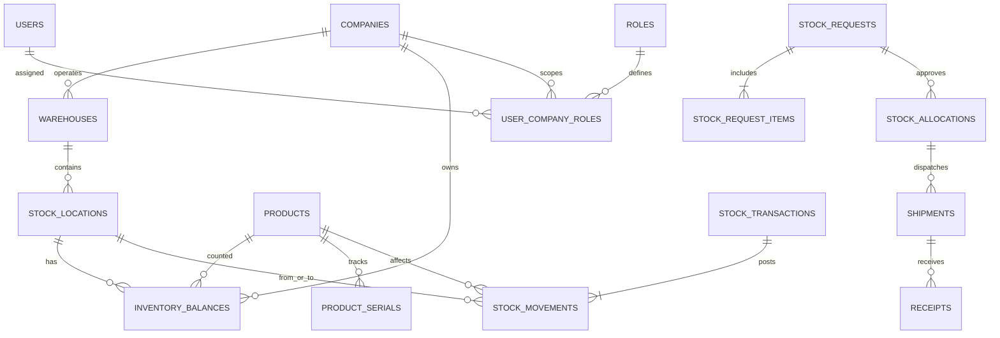

# DATABASE DESIGN — WMS SJLM & GEKA

**Version:** 1.0 · PostgreSQL 16+ recommended · Migration-first implementation

## 1. Principles
One shared database with tenant context. `companies` represent SJLM/GEKA; a warehouse belongs to its **operating company**, while each stock lot/balance identifies an **owner company** separately. SJLM → GEKA internal allocation moves physical stock, not automatically legal ownership. Do not model a GEKA physical receipt as a second asset purchase.

Use `uuid` primary keys, `timestamptz`, `numeric(18,3)` quantity, `numeric(18,2)` currency where applicable, `jsonb` for optional specifications, `created_at/updated_at`, explicitly indexed foreign keys and unique document numbers per scope. `company_id` fields must have clear semantics (`operator_company_id`, `owner_company_id`, `requester_company_id`). Monetary reporting depends on signed-off cost/accounting policy.

## 2. Core conceptual relationships


## 3. Table catalog

### Access & master data
| Table | Key fields / constraints | Notes |
|---|---|---|
| `companies` | `id PK`, `code UNIQUE`, `name`, `is_active` | SJLM/GEKA |
| `warehouses` | `id PK`, `operator_company_id FK`, `code UNIQUE`, `name` | Operating entity |
| `stock_locations` | `id PK`, `warehouse_id FK NULL`, `type`, `code`, `custodian_user_id FK NULL` | `WAREHOUSE`, `TRANSIT`, `TECHNICIAN`, `QUARANTINE`, `EXTERNAL`; warehouse may be null for transit/field locations |
| `users` | `id PK`, `email UNIQUE`, `password_hash`, `status` | `argon2id` recommended |
| `roles`, `permissions`, `role_permissions` | unique `code`, join keys | Fine-grained capabilities |
| `user_company_roles` | `(user_id,company_id,role_id)` unique | Tenancy grants |
| `user_warehouse_access` | `(user_id,warehouse_id)` unique | Optional narrower grants |
| `product_categories`, `units` | unique code | Unit has conversion rules if enabled |
| `products` | `id PK`, `sku UNIQUE`, `name`, `category_id`, `base_unit_id`, `tracking_type`, `specifications jsonb` | Shared catalogue, not shared stock |
| `product_serials` | `id PK`, `product_id FK`, `serial_number`, `state`, `current_location_id`, `owner_company_id` | Unique `(product_id,serial_number)` and consistent posting |
| `suppliers`, `clients`, `projects` | IDs, company ownership | For purchasing/institutions |

### Inventory
| Table | Key fields / constraints | Notes |
|---|---|---|
| `inventory_balances` | `(owner_company_id,location_id,product_id,condition)` PK, `on_hand_qty CHECK >=0`, `version` | Materialized balance; includes only physically held, not consumed/installed |
| `stock_reservations` | `id`, owner, location, product, qty, state, `reference_type`, `reference_id` | Active quantity subtracted from usable on-hand |
| `stock_transactions` | `id`, `document_no UNIQUE`, type, reference, state, created/posted_by, posted_at, idempotency_key | Atomic posting journal header |
| `stock_movements` | `id`, transaction_id, product_id, owner_company_id, from_location_id, to_location_id, qty, condition, reversal_of_id | Append-only physical movements; one side can be NULL for external receipt/consumption |
| `stock_serial_movements` | `movement_id`, `product_serial_id` | Exact units in each movement |
| `stock_thresholds` | `(warehouse_id,product_id)` unique, min_qty, reorder_qty | Reminder per warehouse |
| `stock_opnames`, `stock_opname_items` | location, cutoff, expected, counted, reason, approval | Count owner + condition dimensions |
| `stock_discrepancies` | receipt, product, expected, accepted, damaged, missing, reason, resolution | Track all differences |

### Internal allocation
| Table | Key fields / constraints | Notes |
|---|---|---|
| `stock_requests` | `id`, `requester_company_id`, source/destination locations or warehouses, `status`, request_no | GEKA→SJLM |
| `stock_request_items` | request_id, product_id, requested_qty, approved_qty | Partial approval |
| `stock_allocations`, `stock_allocation_items` | request_id, ISA number, reserved quantities, status | Approved internal allocation |
| `shipments`, `shipment_items` | allocation_id, transit_location_id, shipped quantities, dispatch time | Multiple shipments per allocation |
| `receipts`, `receipt_items` | shipment_id, destination, accepted/damaged/missing quantities | Multiple receipts per shipment; prevent overreceipt |
| `approval_history` | actor, document type/id, decision, comment, timestamp | Non-destructive |
| `attachments` | storage key, MIME, document type/id, uploaded_by | Access policy inherits document |

### Technician & project
| Table | Key fields / constraints | Notes |
|---|---|---|
| `work_orders` | company_id, external_ref, technician_id, status | Can link existing service desk |
| `technician_issues`, `technician_issue_items` | work_order_id, custodian, issue/no, qty | Move to custody location |
| `technician_usages` | issue item, serial (nullable), `action`, qty, customer/job reference | `INSTALLED`, `CONSUMED`, `RETURNED`, `DAMAGED`, `LOST` |
| `purchase_requests`, `purchase_orders`, `purchase_order_items` | company, supplier, refs, qty, costs | Phase 2 richer procurement |
| `project_dispatches` | project_id, shipment reference, proof of delivery | SJLM institutional delivery |
| `audit_logs` | actor, action, resource, tenant, metadata, timestamp, request_id | Immutable event trail |

## 4. SQL skeleton (foundation only; not an executable full migration)
```sql
CREATE EXTENSION IF NOT EXISTS pgcrypto;
CREATE TABLE companies (
 id uuid PRIMARY KEY DEFAULT gen_random_uuid(),
 code text NOT NULL UNIQUE,
 name text NOT NULL,
 is_active boolean NOT NULL DEFAULT true,
 created_at timestamptz NOT NULL DEFAULT now()
);
CREATE TABLE warehouses (
 id uuid PRIMARY KEY DEFAULT gen_random_uuid(),
 operator_company_id uuid NOT NULL REFERENCES companies(id),
 code text NOT NULL UNIQUE,
 name text NOT NULL
);
CREATE TABLE products (
 id uuid PRIMARY KEY DEFAULT gen_random_uuid(),
 sku text NOT NULL UNIQUE,
 name text NOT NULL,
 tracking_type text NOT NULL CHECK (tracking_type IN ('QUANTITY','SERIAL')),
 specifications jsonb NOT NULL DEFAULT '{}'::jsonb
);
CREATE TABLE stock_locations (
 id uuid PRIMARY KEY DEFAULT gen_random_uuid(),
 warehouse_id uuid REFERENCES warehouses(id),
 code text NOT NULL UNIQUE,
 type text NOT NULL CHECK (type IN
   ('WAREHOUSE','TRANSIT','TECHNICIAN','QUARANTINE','EXTERNAL')),
 custodian_user_id uuid,
 CHECK ((type = 'WAREHOUSE' AND warehouse_id IS NOT NULL)
     OR type <> 'WAREHOUSE')
);
CREATE TABLE inventory_balances (
 owner_company_id uuid NOT NULL REFERENCES companies(id),
 location_id uuid NOT NULL REFERENCES stock_locations(id),
 product_id uuid NOT NULL REFERENCES products(id),
 condition text NOT NULL CHECK (condition IN ('USABLE','DAMAGED','QUARANTINE')),
 on_hand_qty numeric(18,3) NOT NULL DEFAULT 0 CHECK (on_hand_qty >= 0),
 version bigint NOT NULL DEFAULT 0,
 PRIMARY KEY(owner_company_id,location_id,product_id,condition)
);
CREATE INDEX idx_inventory_product ON inventory_balances(product_id);
CREATE INDEX idx_inventory_location ON inventory_balances(location_id);
CREATE TABLE stock_transactions (
 id uuid PRIMARY KEY DEFAULT gen_random_uuid(),
 document_no text NOT NULL UNIQUE,
 transaction_type text NOT NULL,
 status text NOT NULL CHECK (status IN ('DRAFT','POSTED','REVERSED')),
 reference_type text,
 reference_id uuid,
 idempotency_key text UNIQUE,
 created_at timestamptz NOT NULL DEFAULT now(),
 posted_at timestamptz
);
CREATE TABLE stock_movements (
 id uuid PRIMARY KEY DEFAULT gen_random_uuid(),
 transaction_id uuid NOT NULL REFERENCES stock_transactions(id),
 owner_company_id uuid NOT NULL REFERENCES companies(id),
 product_id uuid NOT NULL REFERENCES products(id),
 from_location_id uuid REFERENCES stock_locations(id),
 to_location_id uuid REFERENCES stock_locations(id),
 condition text NOT NULL CHECK (condition IN ('USABLE','DAMAGED','QUARANTINE')),
 quantity numeric(18,3) NOT NULL CHECK (quantity > 0),
 reversal_of_id uuid REFERENCES stock_movements(id),
 created_at timestamptz NOT NULL DEFAULT now(),
 CHECK (from_location_id IS DISTINCT FROM to_location_id),
 CHECK (from_location_id IS NOT NULL OR to_location_id IS NOT NULL)
);
CREATE INDEX idx_stock_movements_product_time ON stock_movements(product_id,created_at DESC);
INSERT INTO companies(code,name) VALUES ('SJLM','SJLM'),('GEKA','GEKA');
```

**Important:** this skeleton deliberately omits some references (e.g. `users` foreign keys), state tables, and all service/transaction logic. Do not deploy as a complete schema. Run version-controlled migrations with automated tests.

## 5. Inventory transaction algorithm
For a movement from source to destination:
1. Authenticate and authorize document, origin/destination, company, owner and acting user.
2. Validate status transition, approved quantities, item unit, serials, conditions, idempotency key.
3. Start one PostgreSQL transaction; use deterministic row locking for affected balances and active reservations (e.g. `SELECT ... FOR UPDATE`) to prevent races/deadlocks.
4. Ensure source **usable available** (`on_hand - reserved`) is sufficient for the action, taking into account *its own reservation* on dispatch; release/consume matching reservation atomically.
5. Insert stock transaction + immutable movements and serial links.
6. Decrement source, increment destination where applicable, increment versions; reject underflow.
7. Transition business document status and record approval/audit trail.
8. Commit; notification/outbox events publish only after commit.
9. Retry with same idempotency key returns original result without reposting.

For `TRANSIT` locations, on dispatch decrease SJLM storage and increase transit; on receipt decrease transit and increase GEKA warehouse or quarantine. **Never add to both warehouse balances.** For consumption, the destination is null and unit leaves physical stock; an installed fixed asset/device record may be created separately.

## 6. Required constraints and checks
- Unique SKU, company code, warehouse code, document number and idempotency key per defined scope.
- Foreign keys and scope checks validate warehouse operator/owner relationship; service guards required when FK cannot express tenant equality.
- Quantity positive per movement, no stock underflow, valid status transition only.
- For serial-tracked product, one serial per unit (integer quantity), serial not allocated to two active locations; validate serial ownership and source location.
- Receipt cannot exceed dispatched minus prior receipts; discrepancies explicitly tracked.
- No self-approval for restricted transactions, no edits to posted movements; reverse instead.
- Technician custody location linked to assigned user; only that user or permitted supervisor can read/close custody.
- Only approved inventory changes posted; canceled documents cannot silently change stock.

## 7. Ownership and valuation
Separate **physical location view** from **ownership view**. A GEKA warehouse can hold 20 ONU owned by SJLM. A location report shows 20 in GEKA; an ownership report still shows those 20 against SJLM. Combined report must not add owner and physical totals together. Cost layers/average cost and accounting journal mappings need finance sign-off before financial valuation is labeled official.

## 8. Performance, backup and migration
Index FK columns, common filters `(owner_company_id, location_id, product_id)`, `created_at`, request/approval states. Use paginated list queries, avoid unbounded JSON arrays. Back up DB daily, consider PITR, test restores quarterly, encrypt secrets at rest, minimum database grants. Seed only companies/roles/permissions in production; never ship demo credentials. Automated tests include concurrent dispatch, partial receipt, returns, cancellation, duplicate retry, broken authorization, serial duplication, reporting reconciliation.
