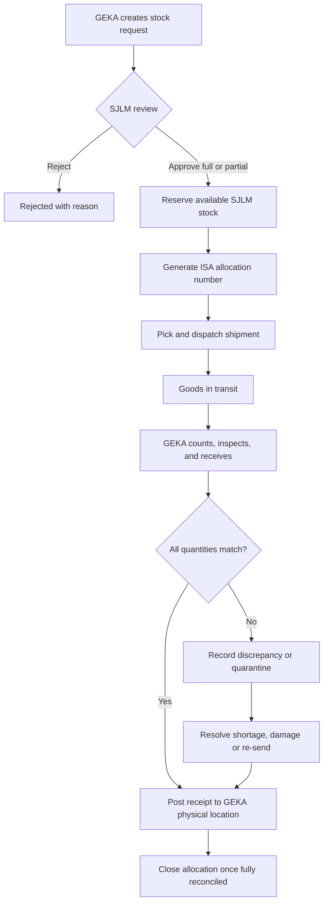

# SYSTEM MAP — WMS SJLM & GEKA

**Version:** 1.0 (implementation blueprint)  
**Status:** Draft for stakeholder approval  
**Stack:** Node.js (ESM), Express, PostgreSQL, server-rendered HTML + Bootstrap 5, optional PWA  
**Timezone:** Asia/Jakarta; persist timestamps as `timestamptz` in UTC.

## 1. Purpose and boundaries
Build one multi-company Warehouse Management System for SJLM (central sourcing/warehouse, external institutional projects) and GEKA (operational warehouse, technician distribution). SJLM → GEKA moves are **internal allocations without sale/invoice**. This process definition does *not* assume a legal change of inventory ownership. Track **owner company**, **physical warehouse/location**, **custodian**, and **status** independently. Initial policy: inventory sourced by SJLM stays owned by SJLM when physically allocated to GEKA, pending accounting confirmation. Policy must be configurable and approved before financial reports go live.

### Included in MVP
- Shared product catalog with SKU, category, unit, specifications, tracking mode, minimum stock per location.
- Separate company/warehouse access; admin/management cross-company view on explicit authorization.
- Goods receiving from supplier; putaway; inventory availability.
- GEKA stock requests to SJLM; approvals, reservations, allocation, dispatch, receipt and discrepancies; partial fulfillment.
- Technician requests, issue to custody, consumption/installation and return.
- Stock opname, adjustments with approval and immutable ledger.
- Audit trail, core reports, low-stock notifications, attachments.

### Deferred enhancements
- Barcode/QR, mobile camera scanning, PWA offline queue, customer installation system integration, procurement costing, full institutional project module, BAST e-signature, automated reorder predictions, external accounting integration.
- MVP may offer manual supplier and project references; do not misrepresent this as a complete procurement/accounting subsystem.

### Non-goals
- No invoicing between SJLM and GEKA for allocation.
- No direct edit of quantity balances by frontend or ordinary staff.
- No assumption that physical movement equals intercompany title transfer.

## 2. Personas, access, and tenancy
Roles: `super_admin`, `management`, `sjlm_admin`, `geka_admin`, `warehouse_head`, `warehouse_staff`, `technician`, `procurement`, `auditor`. Permissions are granular (`inventory.read`, `request.create`, `request.approve`, `allocation.dispatch`, `receipt.confirm`, `opname.adjust`, etc.), scoped to specific companies/warehouses and optionally project assignments.

**Authorization rule:** authenticate session, resolve active company + authorized warehouses on the server, validate permission *and resource tenancy* for every read/write/API query. Never trust `company_id`, `warehouse_id`, owner, price, or role directly from client. Cross-company workflow uses dedicated service authorization to link SJLM and GEKA; broad cross-tenant query access is not implied. Query filters, compound FKs, service assertions, and optionally PostgreSQL RLS provide defense in depth.

### Example matrix (finalize with owners)
| Capability | SJLM admin | GEKA admin | Technician | Management | Auditor |
|---|---|---|---|---|---|
| View assigned warehouse stock | Yes | Yes | Own custody only | Yes | Read only |
| Create request GEKA→SJLM | May assist | Yes | Own technician requests | Optional | No |
| Approve supplier allocation | Authorized | No | No | Optional escalation | No |
| Dispatch SJLM stock | Authorized | No | No | No | No |
| Confirm GEKA receipt | No | Authorized | No | No | No |
| Issue to technician | No | Authorized | No | No | No |
| Report usage/returns | No | Can confirm | Own assigned goods | No | Read only |
| Approve stock correction | Warehouse head | Warehouse head | No | Escalation | No |

Approvals should avoid requester approving own transaction where possible (four-eyes principle).

## 3. Locations and ownership
- `warehouse`: managed by a company (SJLM central, GEKA operational).
- `location`: bin/rack, staging, in-transit, quarantine/damaged, or individual technician custody.
- `owner_company_id`: accounting/legal inventory owner independent of warehouse operator.
- `custodian_user_id`: nullable; assigned for technician custody or accountable receipt.
- `inventory_status`: available, reserved, in_transit, quarantine, damaged, consumed, installed, written_off as distinct physical/lifecycle transitions, not one generic quantity.
- `stock_available = physical_usable_on_hand − active_reservations`; never count in-transit or consumed stock as warehouse availability.
- Do not sum installed or consumed goods into on-hand inventory.

## 4. Core flows and states

### 4.1 Supplier → SJLM
`DRAFT receipt → INSPECTING → CONFIRMED (or DISCREPANCY)`.
Record supplier, document reference, product SKU, quantities, units, serials, condition, receiver, date. Confirmed acceptable quantities generate inventory ledger entries and increment SJLM location balances. Damaged/unverified goods enter quarantine instead of available inventory.

### 4.2 GEKA requests allocation from SJLM

Status model:
- Request: `draft`, `submitted`, `approved_partial`, `approved`, `rejected`, `cancelled`, `fulfilled_partial`, `fulfilled`.
- Allocation: `approved`, `reserved`, `picking`, `partially_dispatched`, `in_transit`, `partially_received`, `discrepancy`, `completed`, `cancelled`.
- Shipment: `draft`, `dispatched`, `partially_received`, `received`, `discrepancy`.
- Receipt: `draft`, `inspecting`, `confirmed`, `discrepancy`.

**Reservation example:** 100 ONU SJLM on hand → approve 20 → SJLM available 80, on hand 100, reserved 20. Dispatch 20 → SJLM on hand 80, in transit 20; destination GEKA available 0. GEKA confirms 20 → GEKA available 20. Total physical stock stays 100; initial SJLM ownership stays 100 (80 stored SJLM, 20 stored GEKA).

Support partial shipments and receipts. A shipment must have an explicit in-transit location and unique reference. A receipt may record accepted, damaged, and missing quantity. Never auto-receive approved quantities. A correction must reference the original transaction.

### 4.3 GEKA → technician
1. Technician requests products against a work order / job reference.
2. Authorized GEKA staff reviews/approves; available stock reserved.
3. Issuer scans/records serials (where applicable) and technician confirms custody.
4. Inventory moves from GEKA storage to a technician custody location; still on hand, but not in GEKA warehouse available stock.
5. Technician records installed/consumed, returned unused, damaged/lost, with job and customer references (limit customer personal data).
6. Reconcile open allocations; reminders for unreported custody items.

### 4.4 SJLM → government/institution client
`Project/contract request → authorization → reserve → pick → dispatch → proof of delivery/BAST → reconcile`. Ownership/revenue recognition/accounting must be defined separately. If project module is deferred, record external project reference on outbound transactions.

### 4.5 Stock opname
`planned → counting → submitted → reviewed → approved → posted`. Count per location and owner. Freeze or snapshot expected quantities at a cutoff; do not silently overwrite concurrent movements. Differences require reason codes, approvals, and balancing correction postings. History is append-only.

## 5. Pages and navigation
- `/login`, `/dashboard`, `/companies/switch` (authorized accounts only)
- `/products`, `/products/new`, `/products/:id`, `/serials`
- `/inventory`, `/inventory/movements`, `/inventory/low-stock`, `/warehouses/:id/locations`
- `/requests`, `/requests/new`, `/requests/:id`
- `/allocations`, `/allocations/:id`, `/shipments/:id`, `/receipts/:id`
- `/technicians/my-stock`, `/technicians/issues`, `/technicians/usage`
- `/stock-opnames`, `/stock-opnames/:id`
- `/suppliers`, `/purchase-orders` (phase 2 full workflow)
- `/projects`, `/reports`, `/reports/valuation` (valuation subject to accounting policy)
- `/admin/users`, `/admin/roles`, `/admin/companies`, `/admin/warehouses`, `/audit-logs`

Desktop: sidebar + top bar with current company and warehouse. Mobile: responsive forms, high-contrast status chips, large receive/dispatch actions, later camera scans. Every mutation needs confirmation, backend permission check, human-readable error, and audit reference.

## 6. Reports/KPIs
- Stock by physical warehouse, owner, status, product and serial.
- Quantity: on hand, available, reserved, transit, technician custody, quarantine.
- Requests pending, allocations dispatched vs received, discrepancies aging.
- Stock movements by actor/document/date, stock opname variances.
- Low-stock thresholds per warehouse; technician unreturned/unused stock.
- Institutional project goods delivered, with references.
- Financial value/costing **only after ownership and accounting rules validated**; do not double count SJLM-owned stock at GEKA as two companies' assets.

## 7. Non-functional & security requirements
- Server-side sessions stored in PostgreSQL/Redis; secure, HttpOnly, SameSite cookies; CSRF protection for state-changing browser requests; TLS via Nginx; Argon2id password hashes; rate limits, lockout/cooldown and optional MFA.
- Input validation; parameterized queries; secure file upload with MIME validation, size cap, private object storage, access controls.
- Database ACID transactions, row-level locks/serialization for inventory, idempotency keys for dispatch/receipt, unique document codes, optimistic versions.
- Immutable movements and audit trails with correlation id, actor, before/after; no plaintext password/token logging.
- Daily tested backups, WAL/PITR as appropriate, restore drills, migration rollback plan, minimal PostgreSQL roles.
- All numeric quantities use decimal (`NUMERIC(18,3)`), never JavaScript floats for inventory calculations.
- Data retention, backups, accessibility, monitoring, and load targets to be agreed before production.

## 8. MVP acceptance scenarios
1. GEKA cannot open SJLM supplier records or perform SJLM dispatch via ID substitution.
2. SJLM allocation 20 from 100 reserves correctly; no double reservation under simultaneous requests.
3. Dispatch moves quantities to transit; no GEKA available credit until confirmed receipt.
4. Partial receipt (18 good, 1 damaged, 1 missing) creates correct balances and discrepancy.
5. Technician takes 10, installs 6, reports 1 damaged, retains 3: all quantities reconcile.
6. Stock opname delta requires approval and creates reversal/correction ledger entries rather than changing history.
7. Retry of a confirm request with same idempotency key creates no duplicate ledger posting.
8. Combined management stock report avoids double counting ownership and physical-location views.
9. Users without role access receive `403`; attempts are logged safely.
10. Supervisor can trace a SKU/serial from supplier through SJLM, GEKA, to technician/job.

## 9. Pending business decisions
- Confirm legal inventory ownership and accounting treatment of SJLM-owned goods stored at GEKA.
- Determine exact roles, approval limits, emergency withdrawals and segregation of duties.
- Define damaged, missing and loss write-off responsibility.
- Define required technician job/customer identifiers and privacy rules.
- Confirm whether serial tracking is mandatory for ONU/ONT, routers, other devices.
- Define unit conversions (roll ↔ meter, box ↔ piece) and project delivery documents.
